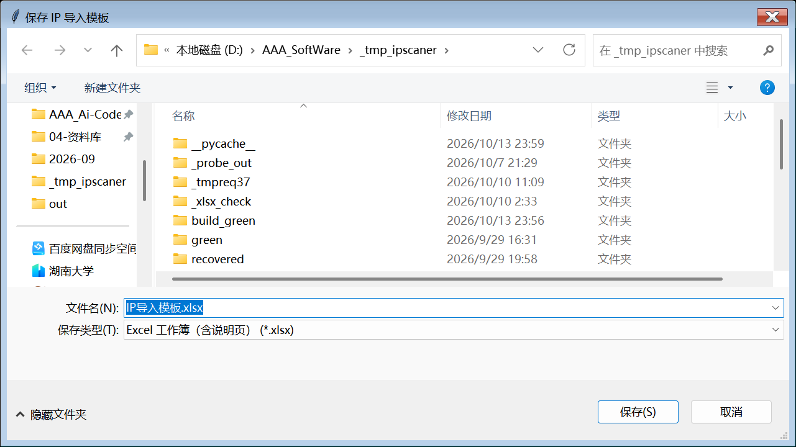
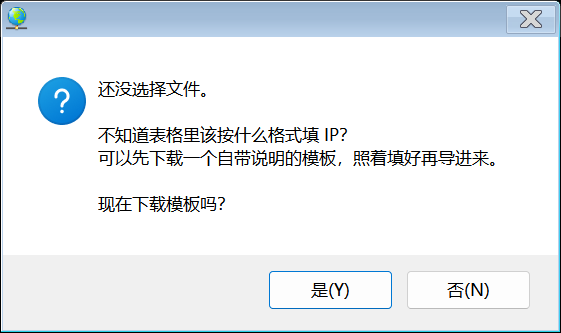

# IPScaner · 局域网 IP 扫描工具（Python 复刻版）

> **单文件绿色版** · 免安装 · Python 3.10 + Tkinter 复刻 · 当前版本 **v1.28.0**
>
> 双击即用，不写注册表、不依赖运行库、不需要装 Python。

原版 IPScaner 是一个用 .NET WinForms 写的局域网扫描小工具。本项目用 **Python 3.10 + Tkinter 完整复刻**了它的界面与功能，并在复刻基础上做了**现代化视觉改版**（对齐 macOS 液态玻璃风格）与**一批缺陷修复**，最后打包成**单个 exe**（约 7.77 MB）。

---

## ✨ 功能一览

### 主界面
- **254 个 IP 色块矩阵** —— 一眼看清整个网段里哪些 IP 在线
- 网卡下拉选择（宽度自适应，长网卡名不再被截断）
- 窗口可自由**缩放 / 最大化**，界面元素随比例重排
- 工具栏：开始扫描 / 停止 / 导出 / 详情 / 复制
- 状态栏实时统计（在线数 / 离线数 / 扫描进度）
- 系统托盘：可最小化到托盘，右键菜单显示 / 隐藏 / 退出

### 快捷工具

| 功能 | 说明 |
|---|---|
| 修改本地 IP | 一键设置本机网卡的 IP / 掩码 / 网关 / DNS |
| **IP 批量扫描** | 输入任意 IP 列表（**可跨网段**）或按网段批量生成，表格化结果；底栏可**下载带说明的导入模板** |
| IP 地址计算器 | 掩码 ↔ 前缀换算、网段与广播地址计算 |
| 端口扫描 | 指定 IP + 端口范围，检测开放端口 |
| 系统端口查看 | 列出本机监听端口及其所属进程 |
| WiFi 密码 | 查看本机已保存的 WiFi 密码 |

### 备注管理
- 给任意 IP 打业务备注（"这是打印机"、"这是 NAS"、"测试机不要动"…）
- **主界面右键 IP 色块 → 备注信息**，即时编辑
- 批量扫描结果表里**右键任意结果行**也能直接编辑备注
- 备注持久化到 `%APPDATA%\IPScaner-Py\memos.json`，重启自动回填

### windows 命令（19 项系统工具快捷入口）
控制面板 · 卸载程序 · 区域语言 · 日期和时间 · 网络连接 · 防火墙 · Internet 属性 · 计算机管理 · 组策略 · 注册表 · 服务 · 系统属性 · **环境变量** · 用户账户 · 设备管理 · 电源选项 · 设备和打印机 · 磁盘管理 · 我的命令（可自定义）

### IP 色块右键菜单（13 项）
复制 IP / 主机名 / MAC · 端口扫描 · 访问共享目录 · 浏览网页 · 调用 Ping / Tracert / Telnet / netstat / ARP · **备注信息** · **导入IP表格**

---

## 🆕 v1.28.0 新增

针对「**批量导入 IP 时会卡顿、像闪退**」「**不知道表格该按什么格式填**」与「**窗口不能放大、缩小**」：

### 1. ⭐ 卡顿的真凶找到了：每台主机都在悄悄起一个 `ping.exe`

这不是修 UI，是把扫描引擎里最大的一处开销换掉了。

**原来怎么扫的**：每 ping 一台主机，就 `subprocess` 起一个系统 `ping.exe`。
扫 254 台 = 起 254 个进程，扫 765 台 = 起 765 个进程。

**为什么会卡**：Windows 上 `subprocess` 创建进程的那一段（`CreateProcess`）
**全程占着 GIL**。254 条扫描线程轮流创建进程时，主线程根本抢不到执行权 ——
UI 心跳被从 80ms 拖到 **1.5~3.0 秒**，Windows 于是把窗口标成「无响应」。
在用户眼里，这就是「卡顿」「闪退」。

**怎么修的**：把 ping 换成 Win32 的 `IcmpSendEcho`（`iphlpapi.dll`）。

- 不创建任何进程 —— 是真正的 ICMP echo request，语义和系统 `ping` 一致
- `ctypes.WinDLL` 调用时会**释放 GIL** —— 主线程不再被饿死（这是修复的关键）
- 返回值契约完全不变 `(alive, rtt_ms)`；任何一步不可用都会**自动回退**原实现

**单变量实验证据**（同一份代码，每次只改一个变量）：

| 条件 | 最大心跳间隔 | 卡顿次数 |
|---|---|---|
| 正常 spawn `ping.exe` | 1529.7 ms | 11 |
| **不 spawn（归因确证）** | **154.6 ms** | **0** |
| 完全空闲（不扫描） | 265.7 ms | 1 |
| workers 254 → 32 | 2219.7 ms | 22（无改善：总 GIL 占用不变） |
| `switchinterval` 5ms → 0.5ms | 6996.1 ms | 14（反而恶化） |

顺带被这个实验**排除**的嫌疑人：Tcl/Treeview 回填（主线程插 765 行只要 104 ms、
0 次卡顿）、修复层轮询、线程垫片派发。

**速度**：`127.0.0.1` 0.190s → **0.002s**；`8.8.8.8` 0.279s → **0.041s**；
254 台整段 5.15s → **0.86s**（快 6 倍）。判定一致性抽查：**0 处分歧**。

### 2. 「下载模板」—— 不用再猜表格该按什么格式填

批量扫描窗底栏，「导入表格」右边并排新增 **「下载模板」** 按钮。

- 存成 **.xlsx** 会带两张工作表：**「使用说明」**（支持的格式 / 三种写法 / 注意事项）+ **「IP列表」**（示例）
- 也可以存 **.csv / .txt**，说明写成 `#` 注释行
- 在「导入IP」的文件选择框上按**取消**，程序会主动问一句「要不要先下载模板」——
  因为在「不知道怎么填」的时候，用户最可能的动作就是取消走人

**模板里的两条硬约束**（都是这套读取器的既有性质，不处理会出事）：

1. 读取器是**从任意文本里正则捞 IP** 的，所以「说明」文字里一旦出现完整的四段 IP，
   它就会被当成**真实扫描目标** → 说明里的示例地址一律写成 `192.168.x.1` 这种**带字母的占位形式**，
   正则不匹配，天然安全
2. 示例数据用 RFC 5737 测试保留段（`192.0.2.x`）→ 用户即使忘了替换、
   直接把模板导进去，也只会去 ping 一个文档专用地址，**不会误扫真实网络**

### 3. 「导入IP」按钮的 UI 与其余按钮统一

产品的按钮是**圆角多边形（polygon）面 + 下沿描边**画出来的，
而缩放画布重写了 `create_rectangle / line / text / image / oval`，
**唯独没重写 `create_polygon`** → 按钮归位逻辑碰不到这个面。
面板底色是近白色 `#FDFDFD`，缺了边框在浅色底上**等于隐形**，
于是新按钮看起来就是「孤零零一个图标 + 一行裸文字」。

修法是把它补进按钮归位清单 + 运行期注入它的设计框。
修完后「导入IP」与「导出」按周长归一的边框像素密度比是 **1.02**，完全同构。

### 4. ⭐ 窗口能放大/缩小了 —— 并且顺手挖出了「闲着自己崩」的真因

这一条连着两件事：您要的「能缩放」，和一直缠着这个工具的「空闲闪退」。

**先说真因**：Tk 在 Windows 上，**每执行一次 `wm resizable`，就会销毁并重建整个顶层窗口**。
修复层原来是在 `MainForm.__init__` 返回之后才补一句 `root.resizable(True, True)` ——
这时窗口上已经挂满了控件，重建顶层窗就等于把它们的宿主抽走 → 悬空引用 →
空闲期由 Tcl 内部抛 `Tcl_Panic`，进程带 `0x80000003` 退出。
**它崩在您什么都没点的时候**，所以看起来像「莫名其妙自己没了」。

一条实验就能坐实（普通 Tk 窗，逐字段读根窗口句柄）：

| 动作 | `winfo_id` | `GetAncestor(GA_ROOT)` |
|---|---|---|
| 基线 | `0x4B10D16` | `0x3571146` |
| `root.resizable(False, False)` | `0x4B10D16` | **`0xD60600`** ← 换了 |
| `root.resizable(True, True)` | `0x4B10D16` | **`0x3581146`** ← 又换 |
| `root.resizable(True, True)` | `0x4B10D16` | **`0xD70600`** ← 又换 |

`winfo_id()` 不变（那是 Tk 内部子窗），**真根窗口一直在换**。

**怎么修的（Plan C）**：与其事后补救，不如让 Tk 根本不发这条消息 ——
在 UI 还没建出来之前（挂钩 `tk.Tk.__init__` 的尾部），把 `root.resizable`
**换成一个恒定返回 `(True, True)` 的包装**。产品原本那句
`root.resizable(False, False)` 于是被改写成「和出生值一样」→ Tk 一条消息都不发、
顶层窗一次都不重建。用户拿到的是**原生**的可缩放 + 可最大化，
`WS_THICKFRAME` 由 Tk 自己维护，不会被 `wm geometry` 抹掉。

**为什么不用更早那条 Win32 兜底（Plan B）**：那条路是把
`WS_THICKFRAME | WS_MAXIMIZEBOX` 硬塞进窗口样式。它 9/9 不崩，
但**尺寸根本改不动** —— Tk 在 `WM_GETMINMAXINFO` 里把最大跟踪尺寸钳死在 `1242×785`，
`SetWindowPos(990×605)` 实测外框恒 `839×523`。**那就是个假交付**，所以只留作兜底开关。

**验收（exe 态实测）**：

| 指标 | 结果 |
|---|---|
| `WM_GETMINMAXINFO` | `ptMinTrack=(23,57)` · **`ptMaxTrack=(99999,99999)`** |
| 拖大到 `1560×880` | 客户区 `1538×824`，zoom **1.130** |
| 缩到 `640×360` | 自动弹回基准 `1252×729`（保底最小尺寸） |
| 最大化（`SC_MAXIMIZE`） | 客户区 `2560×1334`，zoom **1.830** |
| 还原（`SC_RESTORE`） | 正常回到基准 |
| **空闲静置** | **6/6 轮不崩（累计 12/12）** |

关掉这个修复的开关是 `IPSCANER_NO_RESIZE_C=1`（回退 Plan B）。

---

## 🆕 v1.27.0 新增

针对"**手上有张表，里面是不同网段的 IP，想直接 ping 一遍**"这个场景：

### 1. 主界面工具栏「导入IP」
- 主界面工具栏最右新增 **「导入IP」** 按钮
- 点一下 → 选一个 **.xlsx / .csv / .txt** → 自动打开批量扫描窗、灌入 IP、**直接开始 ping**
- 表格里混着不同网段也没关系（如 `192.168.5.65` / `10.20.30.40` / `172.16.8.9` 一起扫）
- 重复 IP 自动去重、结果按 IP 排序

### 2. IP 色块右键菜单也能导入
- 右键任意 IP 色块 → 菜单末尾新增 **「导入IP表格(&I)」**
- 与工具栏按钮走**同一条链路**；批量扫描窗已经开着就**直接复用**，不会重复弹窗

### 3. 修掉一个真机才会暴露的坑
- 「导入 IP 表格」弹出的是 Windows 的 **Vista 版文件对话框（DirectUI）**，
  在部分机器上**收不到任何合成输入**（自动化测试工具点不动它）。
  本项目改用 **UI Automation（COM）** 通道驱动，端到端验证全程真实跑通：
  CSV → 去重 3 个目标 → 自动开扫 → 结果表 3 行 → 完成提示
  「扫描完成，共 3 台主机，正常 0 台」。

---

## 🆕 v1.26.0 新增

针对"一次要扫几百个 IP、要标注用途、还要把结果导出来交差"的真实场景：

### 1. IP 备注 + Excel 导出
- 主界面**右键任意 IP 色块 → 备注信息**，即可给这个 IP 写用途说明
- 批量扫描的**结果表上右键**，同样能直接编辑/清空备注
- 点「导出结果」导出的不再是 CSV，而是**真正的 .xlsx**：
  - 「结果」工作表：**IP / 状态 / 主机名 / MAC / 备注** —— 一眼看出**哪些 IP 通、哪些不通、以及每个 IP 的备注**
  - 「统计」工作表：总数 / 在线 / 离线汇总
- 备注立即写盘（同步落盘 + 原子替换），不怕断电丢数据

### 2. 批量导入表格
- 批量扫描窗底部新增 **「导入表格」** 按钮
- 支持 **.xlsx / .csv / .txt** 三种格式
- 自动从表格里提取四段式 IP 地址，**允许不同网段混在同一个文件里**，一次全扫

### 3. 文档与开源
- 本 README
- 关键源码 + 可复现的构建链路上传到 GitHub

---

## 🚀 快速开始

### 方式一：直接使用（推荐）

1. 到 [**Releases**](https://github.com/azlove2021/IPScaner-Python/releases) 下载 `IPScaner_v1.28.0_portable_win64.exe`
2. 双击运行 —— 单文件绿色版，无需安装、无需 Python 环境

> 也可以直接点这个链接：
> <https://github.com/azlove2021/IPScaner-Python/releases/latest/download/IPScaner_v1.28.0_portable_win64.exe>
>
> 下载后可对照同目录的 `SHA256SUMS.txt` 校验：
> `924a9ddbc6893437d00b053606981c6a36fcf21e2b5b490390f08ea3c605b92f`
>
> （注：GitHub Releases 会把资产名里的非 ASCII 字符替换成 `.`，所以发布包用的是英文名。）

### 方式二：从源码运行

```bash
python src/gui.py
```

依赖：**仅标准库**（tkinter / socket / subprocess / csv / zipfile / ctypes…），不需要 pip install。

---

## 📖 使用说明

### 导入一个表格里的 IP（跨网段，v1.27.0）

1. 点主界面工具栏最右的 **「导入IP」**（或右键任意 IP 色块 → **导入IP表格(&I)**）
2. 选一个 `.xlsx` / `.csv` / `.txt` —— 里面的 IP **可以不在同一网段**
3. 程序会自动打开批量扫描窗、灌入 IP 并 **直接开始 ping**；
   重复 IP 自动去重、结果按 IP 排序，扫完弹出「扫描完成，共 N 台主机，正常 M 台」

> 批量扫描窗已经开着的话会**直接复用**，不会重复弹窗。

#### 不知道怎么填？先拿一个模板（v1.28.0）

- 批量扫描窗底栏点 **「下载模板」**，会存出一个自带 **「使用说明」** 工作表的 `.xlsx`
- 或者在选文件框上直接按**取消** —— 程序会问你一句「要不要先下载模板」
- 模板里的示例 IP 用的是测试保留段（`192.0.2.x`），忘了替换也**不会误扫真实网络**

### 给某个 IP 加备注

1. 扫描完成后，在**主界面**找到目标 IP 色块
2. **右键 → 备注信息**，弹出备注编辑窗
3. 填写内容 → 点「保存」（写入磁盘后窗口自动关闭）
4. 下次打开程序，备注会自动回填到对应 IP

### 批量扫描 → 加备注 → 导出 Excel（推荐流程）

1. 菜单 **快捷工具 → IP批量扫描**
2. 准备要扫描的 IP，二选一：
   - 用顶部 **开始 / 结束 / 网段** 三个输入框 + **生成** 按钮批量生成
   - 或点底部 **导入表格**，选一个 `.xlsx` / `.csv` / `.txt`（**IP 可以不在同一网段**）
3. 点 **开始扫描**，等待结果表填满
4. 在结果行上 **右键 → 编辑备注**，给特殊 IP 写注释
5. 点 **导出结果** → 保存为 `.xlsx`
   → 表格里是 **IP / 状态 / 主机名 / MAC / 备注**，另附统计表

---

## 📸 界面截图

### 主界面

工具栏最右是 v1.27.0 新增的 **「导入IP」**：


### 主界面「导入IP」→ 跨网段自动开扫（v1.27.0）

点「导入IP」选中表格后，自动灌 IP 并开扫，结果直接回填结果表：


扫完弹出完成提示：


### 右键菜单 → 「导入IP表格」（v1.27.0）

右键任意 IP 色块，菜单**末尾**就是新入口：


### 快捷工具菜单


### IP 批量扫描（结果表 + 备注 + 导入表格 + 导出结果）


### 批量扫描底栏（导入表格 / 定时扫描 / 导出结果）






### 导入表格 → 灌入 IP 列表 → 开始扫描

选一个 `.xlsx` / `.csv` / `.txt`，里面的 IP **可以不在同一网段**：


导入后会提示去重排序后的目标数，IP 自动灌进左侧列表：


### 导出 Excel


### IP 色块右键菜单 → 备注信息


### 端口扫描


---

## 🛠 从源码构建单文件 exe

```bash
# 需要 Python 3.10（用 3.11+ 打的包在部分 Win10 上会有兼容问题）
pip install pyinstaller

# ① 准备构建工作区（下面统称 build_green/）
#    绿色版原程序只发布 .pyc，本仓库不含原版字节码，所以工作区要自己拼：
#      build_green/
#      ├── main_opt.py                 ← 拷贝自 src/main_opt.py
#      ├── core/dialogs/gui/mainform/  ← 拷贝自 src/*.py（或用你自己提取的 .pyc）
#      ├── menu_def/popup/theme.py
#      └── assets/                     ← 拷贝自 src/assets/

# ② 由 ui_fix.py 生成运行期钩子（默认写到 ui_fix.py 同目录下的 build_green/）
cd uifix
python gen_hook.py
python gen_hook.py --check     # 应打印 FRESH hook=<sha> src=<sha>

# ③ 把 spec + 钩子放进 build_green/ 后打包
python -m PyInstaller --noconfirm green_onefile.spec
# 产物：build_green/dist/IPScaner.exe
```

> `gen_hook.py` 默认认为 `ui_fix.py` 与它同目录、钩子输出到 `<该目录>/build_green/`；
> 布局不同时用 `IPSCANER_FIXDIR` / `IPSCANER_BUILD` 两个环境变量覆盖即可。

构建链路是三层的，改代码时**必须按顺序**：

```
src/*.py（或绿色版提取的 *.pyc）   ← 复刻源码 / 权威字节码
        ↓
uifix/ui_fix.py                   ← 运行期修复层（所有改动都写这里）
        ↓  gen_hook.py
build_green/rthook_ipscaner_uifix.py   ← 生成的运行时钩子
        ↓  PyInstaller + green_onefile.spec
build_green/dist/IPScaner.exe     ← 单文件成品
```

> ⚠️ 改完 `ui_fix.py` 一定要**重新跑 `gen_hook.py`** 再打包，否则 exe 里还是老逻辑。
> `python gen_hook.py --check` 会打印 `FRESH hook=<sha> src=<sha>`，两个 sha 一致才算新鲜。

---

## 📁 目录结构

```
IPScaner-Python/
├── README.md
├── LICENSE / NOTICE.md     # MIT 许可 + 上游作品与合规说明
├── src/                    # 复刻源码（界面层 + 业务层）
│   ├── gui.py              #   入口：命令行参数 / DPI 感知 / 初始化
│   ├── mainform.py         #   主窗体：单 Canvas 手绘整个客户区
│   ├── popup.py            #   菜单弹出层（独立的 WS_POPUP Toplevel）
│   ├── dialogs.py          #   13 个子窗体
│   ├── theme.py            #   尺寸 / 颜色 / 字体的唯一真源
│   ├── menu_def.py         #   5 个顶级菜单 + 全部菜单项
│   ├── core.py             #   零 GUI 的业务逻辑（扫描 / MAC / 网卡枚举）
│   ├── build.py            #   一键打包
│   └── assets/             #   24 个图标资源
├── uifix/                  # 运行期修复层（本项目的关键代码）
│   ├── ui_fix.py           #   ★ 全部修复 + 新功能都在这里
│   ├── gen_hook.py         #   把 ui_fix.py 编译成 PyInstaller 运行时钩子
│   └── green_onefile.spec  #   单文件打包 spec
├── screenshots/            # 14 张界面截图（README 引用）
└── docs/                   # 逆向分析报告 / UI 审计 / 开发计划 / 验收报告
```

> `build_green/`（构建工作区）**不在仓库里** —— 它包含从绿色版原程序提取的业务模块
> 字节码，属于原版产物。首次构建时按上一节的说明自行拼装即可。

---

## 🔍 技术要点

- **为什么要有"运行期修复层"？**
  绿色版原程序只发布了 `.pyc` 字节码，没有源码。为了既能修 bug 又不破坏原字节码，
  本项目用 **PyInstaller runtime hook** 在导入期对模块做**猴补丁（monkey patch）**：
  所有修复与新功能都写在 `uifix/ui_fix.py`，打包时由 `gen_hook.py` 生成钩子注入。
  好处是**原 `.pyc` 一行不动**，修复可随时增删、可灰度回滚。

- **主界面为什么是"单 Canvas 手绘"？**
  原版 WinForms 的色块矩阵是 254 个独立控件的绝对定位。Tk 里用同等数量的 widget
  会有明显的绘制开销，于是复刻版把整个客户区画在一张 Canvas 上，色块矩阵按
  `主题常量 × DPI 缩放系数` 网格重绘，缩放时整幅重排。

- **菜单为什么要走独立 Toplevel？**
  Canvas 有裁剪边界，23 项的 `windows命令` 下拉会撞上状态栏导致最后几项被压住。
  `popup.py` 用 `Toplevel + overrideredirect + 自绘 Canvas` 实现真·弹出层，
  支持超出主窗口、空间不足自动上翻、子菜单悬停展开、点外部/Esc 关闭。
  （Windows 上原版的 `ToolStripDropDown` 本来就是独立的 `WS_POPUP` 窗口，
  所以这样做反而更贴近原版行为。）

- **扫描不卡界面 / 不闪退**
  扫描跑在工作线程，但 **Tk 不是线程安全的** —— 工作线程直接调 `after()` /
  `Treeview` 方法会触发 Tcl 分配器竞态，表现为**间歇性进程直接消失（无异常、无报错）**。
  修复层装了全局**线程编组垫片**：非主线程的 `after/after_idle/after_cancel`
  与 `Treeview` 读写统一排队，由主线程轮询派发。

- **零依赖读写 .xlsx**
  导出没有引入 openpyxl / xlsxwriter，而是用标准库 `zipfile` + 手写 OOXML
  生成 `.xlsx`（全部单元格走 `inlineStr`，不用维护 sharedStrings 表），
  导入则用 `zipfile` + `xml.etree.ElementTree` 把单元格文本摊平后正则捞 IP ——
  保证单文件 exe 体积不膨胀。

- **打包排除清单是"运行时才炸"的高危区**
  `--exclude-module` 裁多了不会在构建期报错，只会在用户点到那个功能时抛
  `ModuleNotFoundError`，而它往往又被 `except` 吞成一句提示框。
  本项目踩过两次：`decimal`（`fractions` 在函数体内延迟 import）和
  `xml`（读 xlsx 用）。**凡是函数体内的延迟 import，静态分析都扫不到** ——
  定稿排除清单前，必须拿实际用到的模块名去交叉比对一遍。

- **`--windowed` 打包后异常会被静默吞掉**
  冻结版没有控制台，`sys.stderr is None`，Tk 默认的 `report_callback_exception`
  连打印都做不到 —— 按钮回调里出任何错都表现为"点了没反应"。
  修复层接管了它，把异常写进 `%TEMP%\IPScaner_uifix.log`。

---

## 🐞 缺陷修复清单（复刻版相对原版）

| # | 问题 | 处理 |
|---|---|---|
| 1 | 菜单下拉被 Canvas 裁剪，`windows命令` 最后几项点不到 | 改独立弹出层 |
| 2 | 大量文字对比度不足、看不清 | 按主题重设前景/背景色 |
| 3 | 子窗体风格陈旧（十几年前的 WinForms 观感） | 全面现代化改版 |
| 4 | **IP 批量扫描扫描完成后闪退**，看不到结果 | 线程安全垫片（见上） |
| 5 | 端口扫描 1–65536 一个都扫不到 | 修扫描实现 |
| 6 | 「环境变量」等 windows 命令点击报错 | 修命令参数 |
| 7 | 以太网适配器名称显示不全 | 下拉宽度自适应 |
| 8 | 菜单项选中时的浅蓝方块错位 | 高亮块按缩放系数归位 |
| 9 | 子窗体"先弹出小窗、等一会儿才变大" | 首帧即终态 |
| 10 | **窗口不能放大/缩小；且放着不动会自己崩**（`Tcl_Panic` / `0x80000003`） —— 真因是 Tk 在 Windows 上每执行一次 `wm resizable` 就销毁重建顶层 HWND，而修复层是在 UI 建好后补调，等于抽掉控件的宿主 | 改成在 UI 建出**之前**把 `resizable` 换值改写（Plan C）——Tk 一条消息都不发、顶层窗一次都不重建 |
| 11 | 备注弹窗的「保存/关闭」被压成 8px 废条 | 绝对设计坐标归位 |
| 12 | 部分菜单打开有几百毫秒延迟 | 弹层预热与缓存 |
| 13 | **打包版「导入表格」报 `No module named 'xml'`** —— 打包排除清单误排了 `xml` / `pyexpat`，而 `xml.etree.ElementTree` 是在**函数体内**延迟 import 的，静态分析扫不到；源码态有完整标准库所以根本测不出来 | 从排除清单恢复 |
| 14 | **批量导入几百个 IP 时卡顿、像闪退** —— 根因是每 ping 一台就 spawn 一个 `ping.exe`，`CreateProcess` 全程持 GIL 把主线程饿死 1.5~3.0 s | 换成 Win32 `IcmpSendEcho`（不建进程、调用时释放 GIL、可自动回退） |
| 15 | 不知道导入表格该按什么格式填 | 新增带说明的「下载模板」，并在取消选文件时主动询问 |
| 16 | **新增的「导入IP」按钮与其余按钮不同构** —— 按钮面是 polygon，而缩放画布唯独没重写 `create_polygon`，归位逻辑碰不到它 | 补进归位清单 + 运行期注入设计框 |

---

## ⚠️ 已知限制

- 仅支持 **Windows**（依赖 Win32 API：`WMI`、`PrintWindow`、`WS_POPUP` 等）
- 打包用 **Python 3.10**，在部分老版本 Win10 上 3.11+ 打的包会有兼容问题
- 「修改本地 IP」「WiFi 密码」等功能需要**管理员权限**才能生效
- 端口扫描为 TCP connect 扫描，受目标防火墙策略影响
- 主窗体一次性扫描 254 个 IP 约 **1 秒**级（v1.28.0 起改用 ICMP，不再为每台主机创建子进程；实际耗时仍受 ping 超时与网络状况影响）

---

## 📄 免责声明

本项目为**学习与自用**目的对一款局域网工具做的界面/功能复刻与维护。

- 请**仅对你自己拥有或已获得授权扫描**的网络使用本工具
- 未经授权对他人网络进行端口扫描 / 主机探测可能**违反法律法规**
- 使用本工具产生的任何后果由使用者自行承担
- 本工具**不联网、不上报数据**，扫描结果与备注仅保存在本机

原版程序版权归其原作者所有。本仓库只包含复刻代码与运行期修复层，不含原版二进制。
详见 [NOTICE.md](NOTICE.md)。

---

## 📜 许可

复刻代码与运行期修复层以 **MIT** 协议开源，详见 [LICENSE](LICENSE)。
